# Веб-панель Meshpi: можливості

Веб-панель показує й керує вузлом Meshtastic із браузера: чат, список вузлів, **карта мережі з маршрутами**,
графіки, довкілля, налаштування радіо. Працює з **кількома вузлами** (перемикач у шапці) і налаштовує **віддалені
вузли по радіо**. Одна сторінка з вкладками: **Огляд, Повідомлення, Вузли, Мережа, Керування, Радіо, Вузол,
Система**. Адреса вкладки зберігається в посиланні (`/#mesh`), остання відкрита вкладка запам'ятовується.

> **Про скриншоти.** Усі картинки зроблено на демо-сервері (`tools/docs_demo.py`) із **вигаданими** вузлами,
> повідомленнями й показниками. Справжніх вузлів, координат, ключів чи налаштувань радіо тут немає. Вкладки
> «Керування», «Радіо», «Вузол» і «Система» навмисно описано лише текстом.

Зміст: [Вхід](#вхід) · [Огляд](#огляд) · [Повідомлення](#повідомлення) · [Вузли](#вузли) ·
[Мережа](#мережа-карта-маршрутів) · [Кілька вузлів](#кілька-вузлів) · [Керування](#керування-свого-й-віддалених-вузлів) ·
[Радіо](#радіо) · [Вузол](#вузол) · [Система](#система) · [Порівняння із застосунком](#порівняння-із-застосунком-meshtastic-для-android) ·
[Налаштування середовища](#налаштування-середовища) · [Як зняти скриншоти](#як-зняти-скриншоти)

---

## Вхід

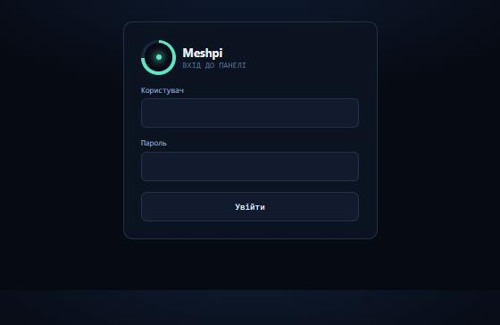

Вхід за логіном і паролем (сесія в cookie на 30 днів, кнопка «Вийти» у шапці). Після входу вас повертає на ту вкладку,
з якої вас розлогінило. Перший пароль створює `deploy.sh`; змінити його можна у вкладці «Система». Без пароля
(прапорець там же) панель відкрита для всієї мережі.

## Огляд

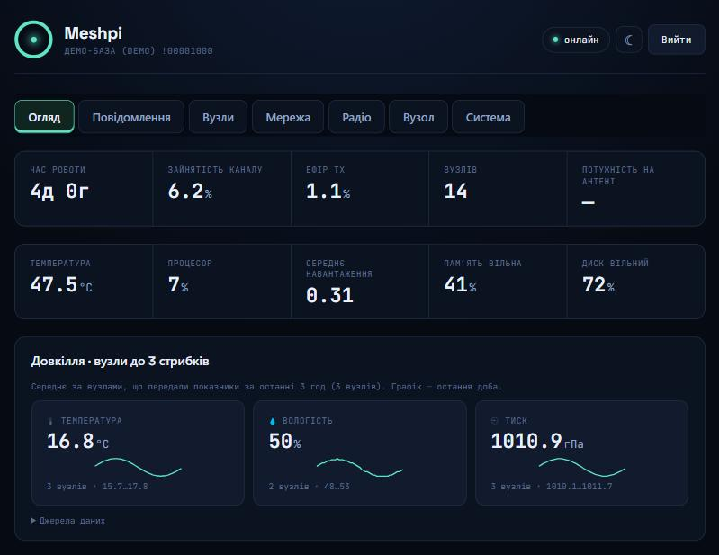

- **Плитки вузла:** час роботи, зайнятість каналу, частка часу в ефірі (TX), кількість вузлів (без MQTT), потужність
  на антені.
- **Плитки системи:** температура, завантаження процесора й середнє навантаження, вільна пам'ять і диск хоста.
- **Довкілля:** середня температура, вологість і тиск (також IAQ, PM2.5, CO₂, освітленість, вітер) за вузлами, що
  передали показники за останні 3 години й розташовані **не далі за 3 стрибки**. На плитці міні-графік за добу, а в
  «Джерелах даних» видно, від яких вузлів і які саме значення. Некоректні показання датчиків (поза правдоподібним
  діапазоном) відкидаються, MQTT-вузли не враховуються.
- **Стан:** чи є SPI-пристрій, чи працює служба `meshtasticd`, чи є з'єднання з проксі.
- **Графіки:** зайнятість каналу, ефір TX і кількість вузлів за 1 год, 6 год, 24 год або 7 діб.

Смужка «Стан» під показниками перевіряє, чи радіо підключене до цієї ж плати (`/dev/spidev0.0`, служба `meshtasticd`). Коли панель працює в Docker на іншому хості, цього немає за визначенням, тому замість двох червоних міток показується нейтральна «радіо на іншій платі», а перевіряється лише зв'язок із вузлом.

## Повідомлення

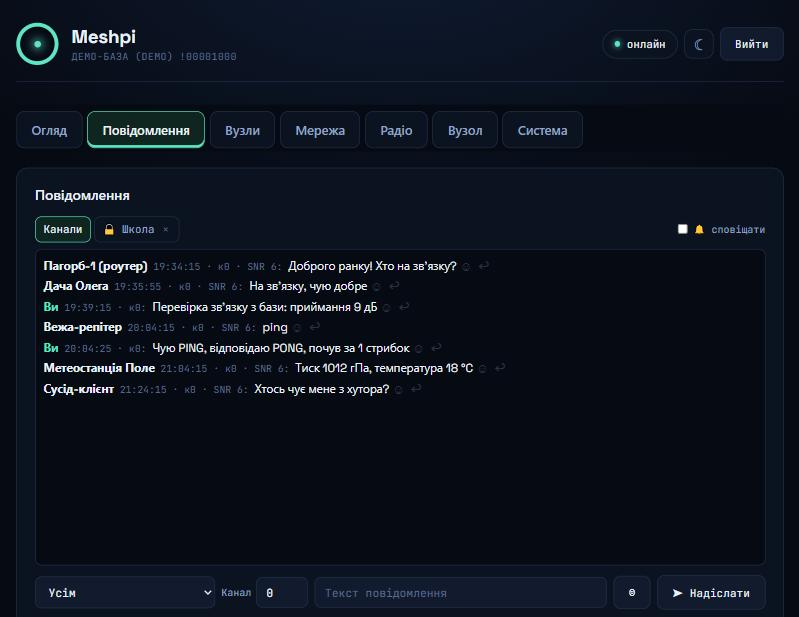

- Розмови розділено: **«Канали»** та окрема вкладка на кожен приватний діалог (🔒). Історія зберігається в базі панелі
  й переживає перезапуск.
- Надсилання: вибір адресата («Усім» або вузол), номер каналу, текст, емодзі. Є відповіді на повідомлення та реакції.
- «🔔 сповіщати» вмикає звук і системне сповіщення про нові повідомлення, поки вкладка відкрита (мелодію можна
  задати у вкладці «Вузол»).
- «🗑 Видалити розмову» стирає приватний діалог з історії.
- **Статус доставки приватних повідомлень** (як галочки в застосунку): «…» надіслано, «✓» сусід ретранслював, «✓✓»
  адресат підтвердив, «✗» не доставлено після повторів. Для повідомлень у канал підтвердження немає.
- **Швидкі повідомлення:** готові фрази, збережені на вузлі (модуль «Готові повідомлення»), з'являються кнопками під полем
  тексту; клік вставляє фразу. Список редагується у «Керуванні» → «Назва, позиція, дії».
- **Автовідповідь:** на «ping» (або «пінг») панель відповідає «Чую PING, відповідаю PONG, почув за N стрибків»
  (вмикається у вкладці «Вузол»).

## Вузли

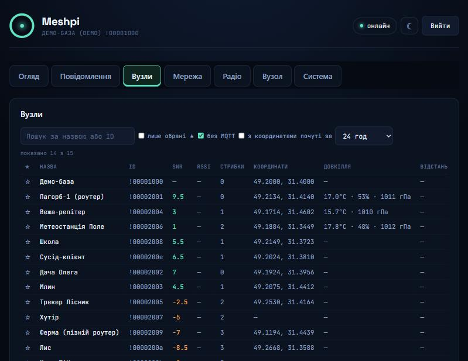

Таблиця всіх відомих вузлів: назва, ID, SNR, RSSI, стрибки, координати, довкілля (температура, вологість, тиск від
самого вузла), відстань від вашого розташування, ознака **MQTT**, час, коли вузол востаннє чути.

- **Пошук** за назвою чи ID, фільтри «лише обрані ★», «з координатами», «почуті за 1 год … увесь час».
- **«без MQTT»** (типово ввімкнено) ховає вузли, відомі лише через MQTT-міст (прапорець `viaMqtt`): це «сміттєві»
  вузли з інших регіонів, які прилітають із інтернету, а не з радіоефіру. Над таблицею є рядок про те, чи ввімкнено MQTT
  на вашому вузлі (лише читання; логін і пароль до MQTT не віддаються).
- Клік по вузлу відкриває запити до нього: **👤 Дані** (назва, модель, роль), **↝ Маршрут** (через які вузли йде
  зв'язок, туди й назад із SNR кожного кроку), **📶 Сигнал**, **🔋 Показники** (батарея, напруга, ефір). Кожен запит це
  передача в ефір; повтор не частіше ніж раз на 30 с. Результати «Маршруту» й «Сигналу» зберігаються (три останні).
- **Дії над вузлом** (в панелі вузла, як на його екрані в застосунку): **★ обраний**, **🚫 ігнорувати**, **🔕 заглушити** і
  **🗑 забути**: це записується у список вузлів на самому вашому вузлі; **📍 запросити позицію** вузла й **📤 надіслати йому
  свою позицію** (задане розташування плати чи геолокація браузера).
- **📈 Графіки телеметрії вузла** (розкривний блок у панелі вузла) за 1 год, 6 год, 24 год або 7 діб: батарея, напруга,
  зайнятість каналу, ефір TX, довкілля (температура, вологість, тиск…) і живлення з датчика INA219/226/260
  («Канал 1: напруга, В» і «струм, мА»), якщо вузол його передає. Історія копиться з пакетів телеметрії, які вузол надсилає сам
  (зазвичай раз на ~30 хв, 7 діб); для вашого вузла канал і ефір додає сама панель. Кнопка «🔋 Показники» лишається для
  разового запиту.

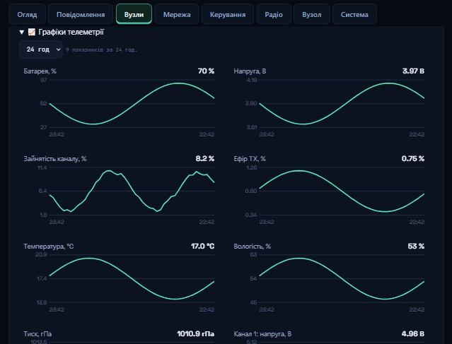

- Під таблицею карта вузлів із координатами (плитки OpenStreetMap, потрібен інтернет у браузері).
- **Точки на карті (waypoints):** як у застосунку Meshtastic. Усі отримані точки показано на карті значками-емодзі й у
  таблиці «Точки на карті». **Клацніть на карті**, щоб поставити нову: назва, опис, значок, строк дії (1 год … без
  строку), канал і «заблокувати» (змінювати й видаляти зможе лише ваш вузол). Точку можна змінити (✎), видалити для всіх
  (🗑) чи знайти на карті (⌖). Точки з MQTT-мосту ігноруються; прострочені зникають самі.

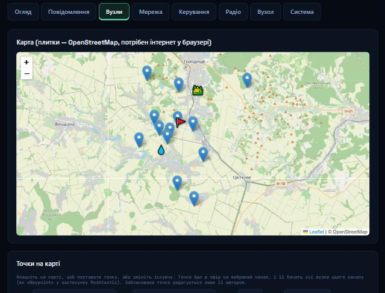

## Події

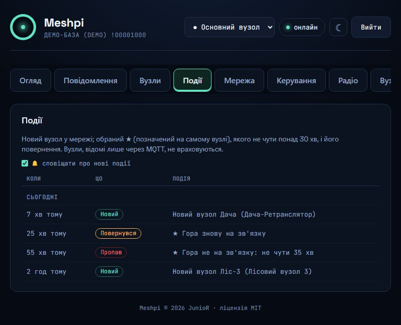

Журнал того, що відбулося в мережі, і сповіщення про це. Панель перевіряє вузол раз на 20 с і записує:

- **Новий** — вузол, якого панель раніше не бачила. Перший запуск лише запам'ятовує вже відомі вузли й нічого не сповіщає.
  Вузли, відомі лише через MQTT-міст, і свій вузол не враховуються.
- **Пропав** — обраний вузол (★, позначений обраним на самому вузлі: «Вузли» → дії над вузлом → «В обрані»), якого не чути понад 30 хв.
  Поріг змінюється змінною `MESHPI_FAV_OFFLINE` (секунди).
- **Повернувся** — той самий обраний вузол знову чутно.
- **Заряд** — низький заряд свого вузла чи обраного (поріг типово 20 %, лише вниз до порога, нова тривога після підйому на 10 пунктів).
- **Ефір** — зайнятість каналу вище порога (типово 40 %) три виміри поспіль (приблизно 15 хв).
- **Перезапуск** — час роботи вузла зменшився: він перезавантажився.
- **Зв'язок втрачено / Зв'язок є** — панель понад 2 хв не бачить вузла і знову його бачить (не частіше за раз на 10 хв).

Кожне підключення має свій журнал (500 останніх подій). Прапорець **«сповіщати про нові події»** вмикає звук і системне
сповіщення браузера, коли вкладка у фоні; на самій вкладці «Події» лічильник непереглянутих. Налаштування прапорця й
позначка «що вже переглянуто» зберігаються лише в цьому браузері. Тут обрані — ті, що позначені на вузлі, а не зірочки ☆
у таблиці «Вузлів» (вони живуть лише в браузері).

Сенсорний екран на Pi веде власний журнал (вкладка «Вузли» → «Події»), який читає Telegram-бот. Це окремі журнали в
різних базах, тож панель, екран і бот можуть повідомляти про одне й те саме в різний момент, а «обрані» на екрані
вибираються на самому екрані, а не на вузлі.

## Мережа: карта маршрутів

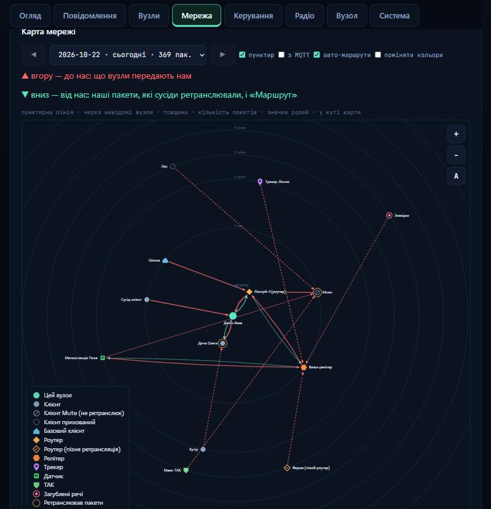

Схема мережі навколо **вашого вузла** (центр). Усе, що тут намальовано, збирається автоматично з радіотрафіку, а
не вводиться вручну.

### Як читати карту

- **Кола це стрибки (хопи) від вас: 1, 2 … 7.** Вузол стоїть на колі свого `hopsAway`. Прямі сусіди (0 стрибків)
  розташовані всередині першого кола. Вузли, чиї стрибки невідомі, стоять на окремому пунктирному колі
  «стрибки невідомі»; для них кількість стрибків береться з графа зв'язків, якщо це можливо.
- **Напрямок на карті це справжній азимут** від вашого розташування, якщо в вузла є координати. Без координат кут
  стабільний (зі скороченого ID), але нічого не означає. Відстань тут передають кола, не кілометри.
- Щоб значки й підписи не налазили, кожен вузол розглядається як прямокутник «значок + підпис»: накладені розсуваються (вздовж кола й трохи по радіусу), а коли на колі тісно, воно саме розширюється. Перевірено на 70 вузлах із довгими назвами. На щільному
  колі кожен другий зсунутий. Підписи йдуть від центру назовні й мають обводку кольору фону, тому читаються поверх ліній.
- **Червоні стрілки: «вгору»**: те, що вузли передають нам (приймання, шлях від вузла до нас).
  **Зелені стрілки: «вниз»**: наші передачі (шлях від нас до вузла). Кольори можна поміняти місцями прапорцем
  «поміняти кольори».
- **Товщина** лінії відповідає кількості пакетів за обрану добу. **Пунктир** означає шлях через вузли, яких ми не
  чули (проміжні ретранслятори невідомі). Прапорець «пунктир» вмикає/вимикає такі лінії.

### Значки ролей

Кожна роль вузла Meshtastic має власну форму. У **лівому нижньому куті карти** показано легенду, але **лише для тих
ролей, що є на карті**.

| Значок | Роль | Значення |
|---|---|---|
| ● | Клієнт (`CLIENT`) | звичайний вузол |
| ⊘ | Клієнт Mute (`CLIENT_MUTE`) | не ретранслює чужі пакети |
| ◌ пунктиром | Клієнт прихований (`CLIENT_HIDDEN`) | не показує себе в ефірі |
| ⌂ | Базовий клієнт (`CLIENT_BASE`) | базова станція для обраних вузлів |
| ◆ | Роутер (`ROUTER`) | ретранслятор |
| ◆ з крапкою | Роутер-клієнт (`ROUTER_CLIENT`) | роутер, який ще й клієнт |
| ◇ з рискою | Роутер (пізня ретрансляція, `ROUTER_LATE`) | ретранслює останнім |
| ⬢ | Репітер (`REPEATER`) | чистий ретранслятор |
| 📍 | Трекер (`TRACKER`) | передає позицію |
| ▣ з хвилею | Датчик (`SENSOR`) | передає показники довкілля |
| ⛉ | TAK (`TAK`), TAK-трекер (`TAK_TRACKER`) | для ATAK |
| ◎ | Загублені речі (`LOST_AND_FOUND`) | маячок пошуку |

Додаткові позначки навколо значка: **жовте кільце** «Ретранслював пакети» (клієнт, якого було зафіксовано як
ретранслятор), **фіолетове пунктирне кільце** «Через MQTT» (коли ввімкнено «з MQTT»).

### Підказка при наведенні

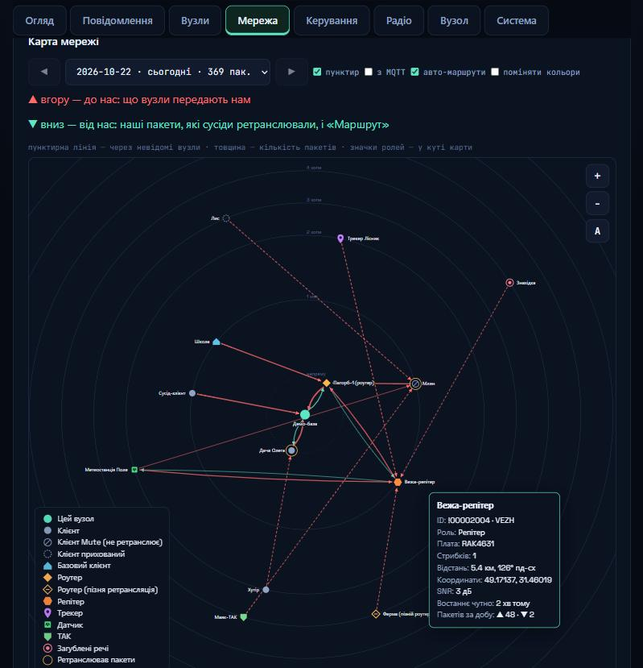

Наведіть курсор на вузол: повна назва, ID й коротка назва, роль, плата, стрибки, відстань і азимут (якщо відомі
координати), координати, SNR, RSSI, коли востаннє чути, кількість пакетів за добу вгору й вниз, джерело (MQTT).

### Маршрути: вгору й вниз часто різні

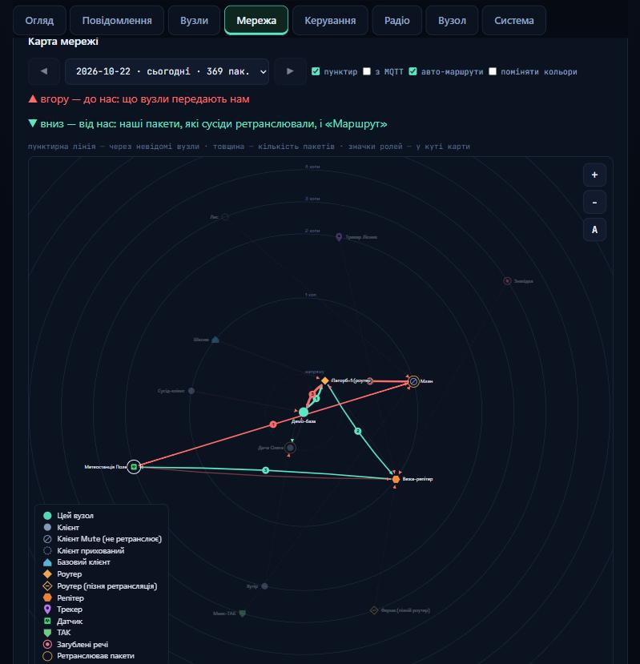

Клацніть вузол на карті або рядок у таблиці «Маршрути до нас». Шлях вузла до нас підсвітиться
**червоним**, шлях від нас до нього **зеленим**, кроки пронумеровано кружечками. Решта карти тьмяніє. Під картою
показано обидва шляхи текстом. На знімку червоний шлях іде через «Млин», а зелений через «Вежу-репітер»: це нормальна
ситуація, маршрути туди й назад часто відрізняються.

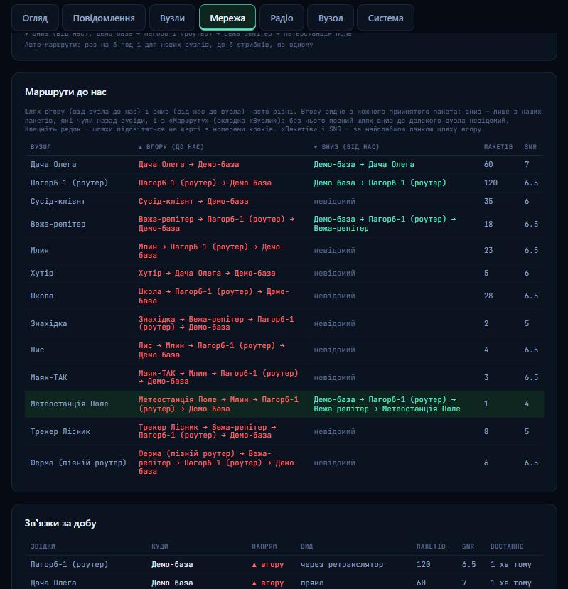

- **«Маршрути до нас»:** для кожного вузла найкоротший шлях вгору, шлях вниз (якщо відомий), кількість пакетів і SNR
  за найслабшою ланкою. Клацніть рядок, щоб підсвітити маршрут на карті.
- **«Зв'язки за добу»:** усі пари «звідки → куди» з напрямком, видом (пряме / через ретранслятор / через невідомі
  вузли), кількістю пакетів, SNR і часом останнього.

### Звідки беруться дані

| Джерело | Що дає |
|---|---|
| Кожен прийнятий пакет | відправник → ретранслятор → ми (за `relayNode` і лічильниками стрибків) |
| Наші пакети, які сусід ретранслював і ми почули назад | шлях «вниз» до безпосереднього сусіда |
| Відповіді «Маршруту» (ручні й автоматичні) | **повний** шлях туди й назад із SNR кожного кроку |
| NeighborInfo від вузлів | кого чує сам вузол |

Чесні обмеження: ретранслятор у пакеті позначений лише **останнім байтом ID**, тому за кількох вузлів з однаковим
байтом панель бере найближчого; якщо найближчих кілька, лінію **не малює** (краще без лінії, ніж хибна). Повний
шлях «вниз» до далекого вузла пасивно побачити неможливо, його дає лише «Маршрут», тому у таблиці він «невідомий»,
доки вузлу не надіслано запит.

### Архів по днях

Зв'язки зберігаються по добах (60 діб) у базі. Кнопки **◀ ▶** і список обирають добу, на карті малюється саме вона.
Для минулих діб підписи беруться з поточного списку вузлів (відсутні показано як ID).

### Керування картою

- **`+` / `−`** у правому верхньому куті масштабують, **`A`** (авто) повертає автомасштаб. Колесо миші теж масштабує,
  перетягування зсуває. Після ручного масштабу автоматичне вміщення вимикається, поки не натиснути **A** або
  не змінити добу.
- Прапорці: **пунктир**, **з MQTT** (за замовчуванням вузли лише з MQTT-мосту сховано), **авто-маршрути**,
  **поміняти кольори**.

### Джерело даних карти: мережа очима іншого вузла

Блок «Джерело даних карти» на початку вкладки «Мережа» має перемикач **«дивитись очима вузла»**. Коли він увімкнений, центром
карти стає вибраний вузол (наприклад, роутер, доступний лише по радіо), кола рахуються від нього, а «вгору» означає «ближче
до нього». Вимкнений: карта як раніше, з погляду вашого вузла. Налаштування зберігається на сервері для кожного підключення
(`data/netview.json`) і однакове для всіх, хто дивиться панель, зокрема для ролі «лише перегляд».

**Звідки беруться дані.** Панель не може вичитати базу вузлів чи список сусідів у віддаленого вузла по радіо (такого запиту
в протоколі немає), тому картина складається з того, що вона сама чула: хто ретранслював пакети (пряме чуття вузла й його
сусідів), які шляхи показали відповіді «Маршрут» і що вузол повідомив через NeighborInfo. Відстані від нового центра рахуються за
цими зв'язками (мінімальна кількість кроків, напрямок не важливий), тому лічильник стрибків із бази самого вузла в цьому
режимі не використовується. Чим більше даних, тим повніша картина.

- **«Запитати маршрут і дані»** надсилає вузлу «Маршрут» і «Показники» (передача в ефір, по одному запиту); відповіді додають зв'язки.
- **«NeighborInfo на вузлі»** читає налаштування цього модуля віддаленого вузла. Якщо він вимкнений, вузол не повідомляє про
  сусідів, і карта від його імені залежить лише від ретрансляцій і маршрутів. Панель нічого на вузлі не змінює: увімкнути
  NeighborInfo можна у «Керуванні» самостійно (це зміна налаштувань вузла; мінімальний інтервал повідомлень 4 год).
- Над блоком видно, скільки прямих сусідів, зв'язків і пакетів про вузол відомо за сьогодні.

### Живий режим: пакети летять схемою

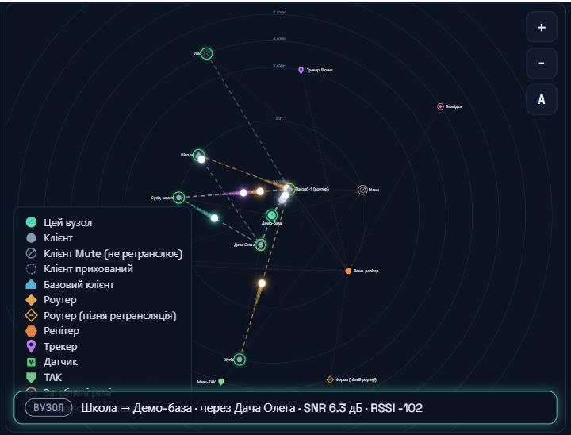

Прапорець **«живий режим»** над схемою (типово вимкнений: схема така, як була) показує трафік у реальному часі. Це лише
відображення: у ефір нічого не передається.

- **Пакети.** Кожен прийнятий пакет пролітає світною кометою від відправника через ретранслятора до вашого вузла (по схемі,
  прямими відрізками). Ретранслятор береться, лише коли його вдалось визначити однозначно: два кандидати з однаковим байтом дають
  пряму лінію, а не хибну. На приймачі розходиться кільце, а лінія ще кілька секунд тьмяніє пунктиром. Колір залежить від типу
  пакета (текст, позиція, телеметрія, маршрут…). Вузол, що щойно передавав чи приймав, світиться зеленим кільцем 30 с. Звичайні
  стрілки на цей час трохи тьмяніють (до половини), щоб комети було видно на густій схемі; загальний вигляд схеми лишається тим самим.
- **Стрічка внизу.** Останній пакет: тип, «від → кому», через кого, SNR і RSSI.
- **Шухляда «Трафік».** Останні пакети списком (тип, хопи, розмір, SNR, RSSI, смужки рівня сигналу); клік по рядку показує вузол
  відправника на схемі. «Пауза» зупиняє потік.
- **Програти.** Повторює записані пакети за 5, 15 чи 60 хв, стиснуті приблизно до 45 с; живий потік на цей час зупиняється.
  Пам'ять журналу пакетів обмежена (останні `MESHPI_PKT_LOG`, типово 1000, зникає при перезапуску), тому за жваву мережу 60 хв
  можуть не вміститись.

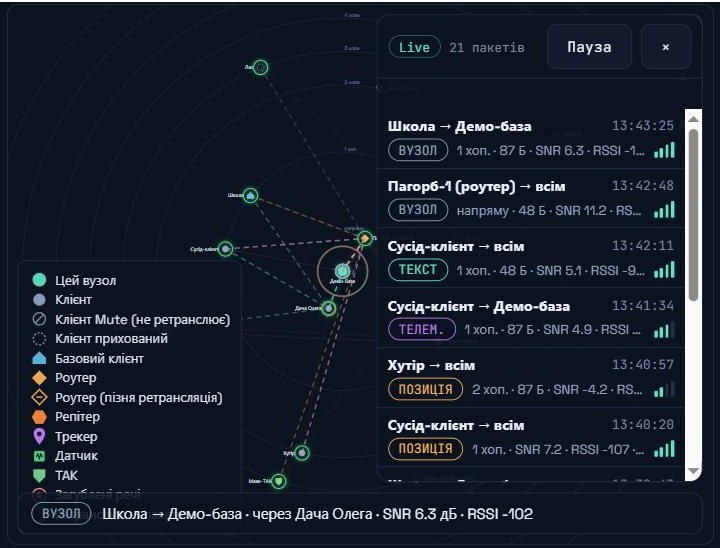

Вузли, яких немає на схемі, не малюються, але їхні пакети є в стрічці та шухляді. Опитування `/api/live` іде раз на 2 с, лише коли
режим увімкнений і вкладка видима; прапорець запам'ятовує браузер. За системної вимоги «зменшити рух» комети не показуються (лишаються
світіння, стрічка й шухляда). Якщо схема показана «очима» іншого вузла, пакети все одно прийняв ваш вузол, тому вони летять до нього.
Роль «лише перегляд» бачить режим повністю.

### Авто-маршрути

Типово ввімкнено. Раз на **3 години** й **одразу для вузла, що щойно з'явився** у списку панель надсилає йому «Маршрут».
Запити йдуть **по одному**: наступний після відповіді (або через 150 с без неї), з паузою 45 с. Це реальні передачі в
ефір, тому панель питає лише вузли **не через MQTT, чутих за останню добу й не далі за 5 стрибків**, і не робить цього під
час сканування пресетів. Стан (кому запитує, довжина черги, наступне коло, останній результат) видно під картою;
вимкнути можна прапорцем «авто-маршрути».

## Здоров'я мережі

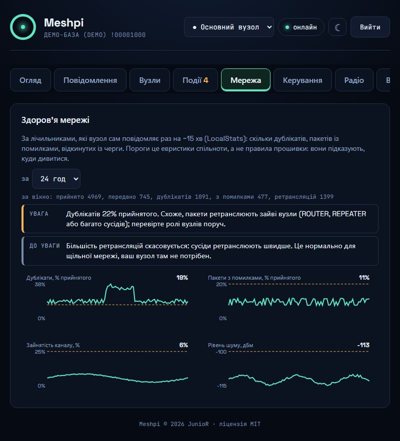

Розділ у вкладці «Мережа». Вузол раз на ~15 хв сам повідомляє лічильники (LocalStats): скільки пакетів прийнято, скільки з
помилками, скільки дублікатів, ретрансляцій, скасованих ретрансляцій, відкинутих із черги передачі, рівень шуму. Панель
записує їх і за різницею між замірами показує висновки та графіки: частку дублікатів, пакетів з помилками, зайнятість
каналу, шум. Пороги (дублікатів понад 15 %, пакетів з помилками понад 20 % при зайнятому ефірі понад 25 %, шум вище
−100 дБм) це **евристики спільноти** (вони з [діагностики mesh-client](https://github.com/Colorado-Mesh/mesh-client/blob/main/docs/diagnostics.md)),
а не правила прошивки: вони підказують, куди дивитися, і нічого не доводять. Дані з'являються після двох замірів
(≈ 30 хв). API: `GET /api/netstats?hours=24`.

## Вимір дальності

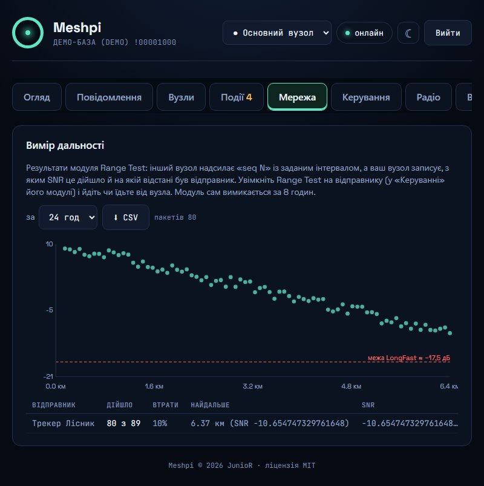

Модуль Range Test на іншому вузлі шле «seq N» з інтервалом; ваш вузол ловить їх, а панель записує SNR, RSSI і відстань до
відправника (за його останньою відомою позицією). У вкладці «Мережа» видно підсумок по відправниках (скільки дійшло з
очікуваного за номерами, найдальша відстань), графік SNR від відстані з межею демодуляції LongFast (≈ −17,5 дБ) і
кнопку «CSV». Range Test вмикається на відправнику у «Керуванні» (модуль сам вимикається за 8 годин); панель сама
нічого не вмикає. Результати зберігаються 14 діб.

## Планувальник лінка

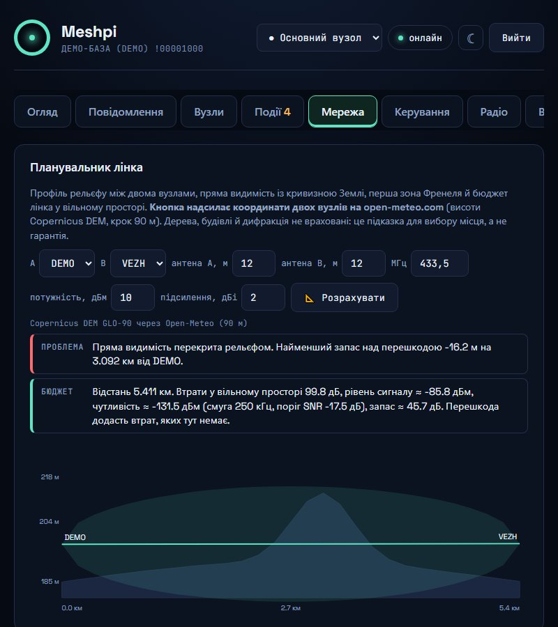

У вкладці «Мережа»: оберіть два вузли з позицією, висоти антен і частоту. Панель бере профіль рельєфу (Copernicus DEM
GLO-90, крок 90 м) з **open-meteo.com**: **координати двох вузлів йдуть на цей сервер, і лише коли ви натиснете кнопку**;
результат кешується на добу. Далі рахується пряма видимість із кривизною Землі (k = 4/3), чистота першої зони Френеля
(добре, якщо вільні 60 %) і бюджет лінка у вільному просторі: втрати, рівень сигналу й запас над чутливістю
(теплова шумова підлога + смуга + 6 дБ + поріг SNR пресету). Дерева, будівлі й дифракція не враховані, це підказка для
вибору місця, а не гарантія: перевіряйте виміром дальності. Типова поправка: на 10 км із антенами по 10 м перша зона
Френеля закрита (потрібні щогли ≈ 28 м), хоча пряма видимість є.

## Сонячний вузол

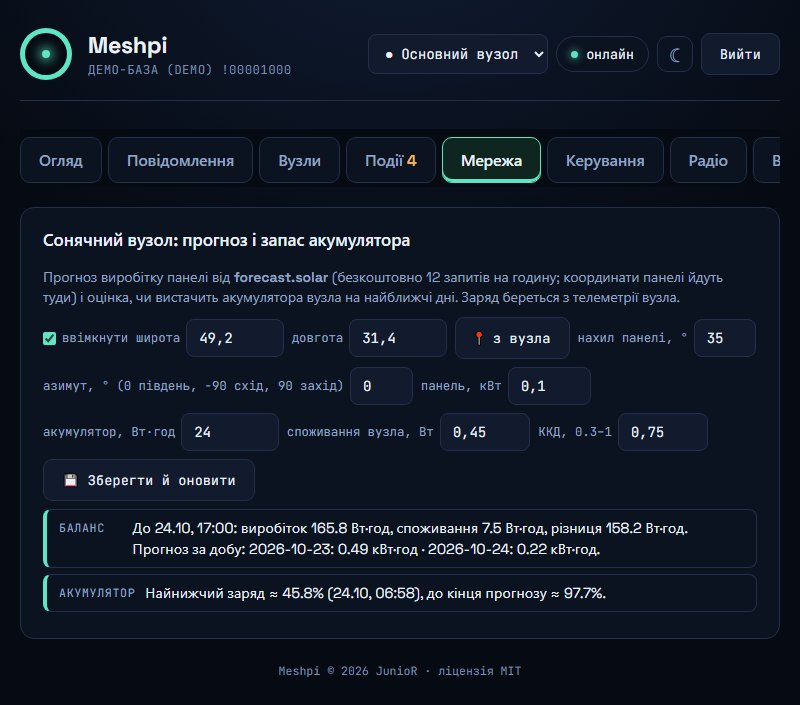

Для вузла на сонячній панелі: координати, нахил, азимут (0 південь), потужність панелі, ємність акумулятора й споживання.
Панель питає **forecast.solar** (безкоштовно 12 запитів на годину, відповідь кешується на годину; координати панелі йдуть на
цей сервер лише за кнопкою) і моделює заряд акумулятора з кроком 15 хв від поточного заряду вузла: показує баланс, найнижчий
заряд і час можливого розряду. Прогноз охоплює сьогодні й завтра. Налаштування лежать у `data/solar.json`.

## Журнал пакетів: фільтри й CSV

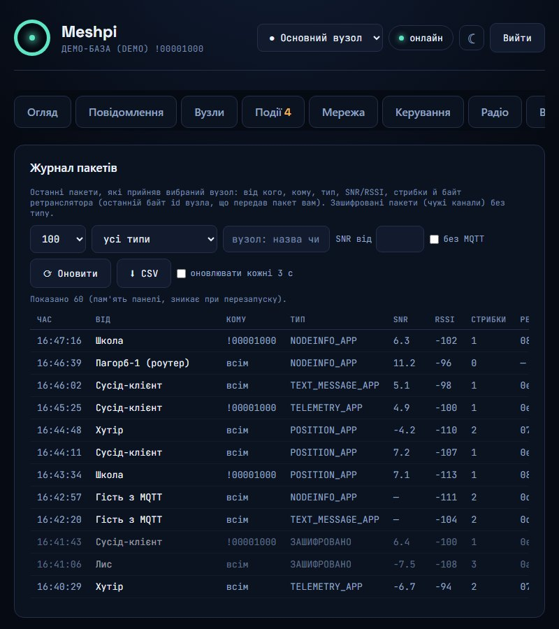

Журнал пакетів (вкладка «Система») тримає до 1000 останніх пакетів у пам'яті (`MESHPI_PKT_LOG`). Фільтри: тип, вузол (назва чи id,
також серед адресатів), SNR від, без MQTT. Кнопка «CSV» завантажує ті самі відфільтровані рядки (UTF-8 з BOM для Excel;
клітинки, що починаються на `=`, `+`, `-`, `@`, екрануються від формул).

## Карти без інтернету

Leaflet лежить у `static/vendor/leaflet` (файли ідентичні випуску 1.9.4, збігаються з раніше закріпленими хешами), тож
інтерфейс більше не залежить від `unpkg.com`; без інтернету карта показує вузли на темному тлі. Плитки типово беруться з
OpenStreetMap (потрібен інтернет у браузері). Для повної роботи офлайн вкажіть власний сервер плиток змінною
`MESHPI_TILE_URL` (наприклад `http://<адреса-сервера>:8081/tiles/{z}/{x}/{y}.png`; `MESHPI_TILE_ATTR` і `MESHPI_TILE_ZOOM` задають
підпис і максимальне наближення). Не качайте плитки OSM наперед і не ставте кеш-проксі до них: [політика](https://operations.osmfoundation.org/policies/tiles/)
це забороняє; для офлайну користуйтесь власними плитками (векторні, PMTiles тощо).

## Кілька вузлів

Панель може одночасно працювати з кількома вузлами (кілька Pi з радіо, чи один вузол і запасний). **Система → «Вузли
панелі»**: список підключень (назва, адреса, стан), форма «＋ Додати вузол», кнопки «Показати», «✎» (змінити назву чи адресу)
і «✕» (прибрати зі списку, історія в базі лишається). Адреса це TCP API `meshtasticd` (порт 4403) або проксі.

- Панель **тримає з'єднання з усіма** вузлами й веде історію кожного окремо: повідомлення, графіки, довкілля, зв'язки карти
  мережі, результати «Маршруту», журнал пакетів. Авто-маршрути йдуть по колу по всіх вузлах (по одному запиту за раз).
- Селектор у шапці («● назва») обирає, чий вузол показано: усі вкладки перемикаються на нього. Вибір зберігається
  в сесії браузера, тож у двох браузерах можна дивитися на різні вузли.
- Список лежить у `data/nodes.json` (до 8 вузлів). Стара база від одного вузла автоматично стає даними підключення
  «main»; нічого переносити не треба.

## Керування свого й віддалених вузлів

Вкладка «Керування» дає **усі налаштування, що є в застосунку Meshtastic**, для вузла, підключеного до панелі, і для **будь-якого
вузла мережі по радіо**. Зверху вибирається «Цей вузол» чи вузол зі списку («· по радіо»).

- **Розділи конфігурації:** пристрій (роль, режим ретрансляції…), позиція, живлення, мережа (Wi-Fi), екран, LoRa, Bluetooth,
  безпека (лише читання). **Модулі:** MQTT, серійний порт, зовнішні сповіщення, Store & Forward, тест дальності,
  телеметрія, готові повідомлення, аудіо, віддалені GPIO, інфо про сусідів, підсвітка, датчик виявлення, Pax, статус,
  керування трафіком, TAK. Форми будуються з опису полів прошивки, тож нові поля з'являються самі.
- **Канали:** усі 8: роль, назва, PSK (з кнопкою «нові ключі»), вивантаження/завантаження MQTT, точність позиції, вимкнення
  звуку. Для вузла панелі є **«▦ QR і посилання»**: QR-код і текст посилання на канали, як «Поділитися каналом» у застосунку.
- **Назва, позиція, дії:** назва вузла (довга й коротка), фіксована позиція, версія прошивки й плата, готові
  повідомлення, перезавантаження, вимкнення, синхронізація часу, очищення списку вузлів, скидання налаштувань.
- Свій вузол читається миттєво й автоматично. **Віддалений** потребує радіообміну: кожне читання це передача в ефір і
  займає від кількох до десятків секунд, статус показується під заголовком. Операції йдуть **по одній** на підключення.

**Умова для віддаленого керування:** на віддаленому вузлі в `security.admin_key` має бути публічний ключ вашого вузла
(PKC-адмін), і ваш вузол має знати його відкритий ключ (чути його NodeInfo). Інакше панель покаже зрозумілу причину
(«ключ цього вузла не внесено в security.admin_key» тощо).

**Запобіжники:** розділ `security` (приватний ключ вузла) доступний лише для читання й без самого ключа: запис із порожнім
ключем міг би стерти особистість вузла. Небезпечні дії (вимкнення, скидання, очищення списку вузлів, забути вузол)
вимагають підтвердження. Зміна LoRa на віддаленому вузлі може обірвати зв'язок із ним, якщо регіон чи пресет не збігаються
з мережею: панель про це попереджає перед записом. Панель нічого не змінює сама: усе записується лише за вашою кнопкою.

### Нестійкий зв'язок із віддаленим вузлом

Кожен запит **на читання** до віддаленого вузла (розділи, канали, назва, метадані, готові повідомлення, ключ сесії) повторюється один
раз, якщо відповіді немає за відведений час (до двох спроб по 60 с). **Записи й дії (перезавантаження, скидання, зміна каналу чи налаштувань)
автоматично не повторюються**: повторна дія небезпечна, її за потреби повторюєте ви. Канали по радіо читаються по одному: якщо один не
вдалося прочитати, решта все одно показується, а невдалий з'являється карткою з кнопкою «Прочитати ще раз» (читається лише він). Якщо
два канали поспіль не відповіли, читання зупиняється, решта позначається «не читалось», а якщо не вдалося жодного, показується помилка.
Це не лікує слабкий сигнал і не збільшує ймовірність відповіді, лише не дає одному втраченому пакету зіпсувати все читання.

## Радіо

Налаштування радіо вузла (читаються й записуються через API, тож це працює й у Docker):

- **Регіон, пресет, потужність (дБм), hop limit, слот частоти.** «Зберегти» перезапускає вузол; змінюйте свідомо, це
  впливає на всю мережу й має відповідати закону вашої країни.
- Довідкова таблиця **потужності на антені** залежно від налаштування (за даними виробника модуля й вимірами власника)
  і примітка про стелю потужності, яку накладають прошивка й чип.
- **Потужність:** збирання `meshtasticd` з піднятою стелею (працює лише на самій Pi, не в Docker).
- **Пошук мережі за пресетами:** вузол по черзі перемикається на вибрані пресети, слухає ефір і показує, скільки вузлів і
  пакетів почув на кожному; наприкінці повертає початковий пресет. Під час сканування вузол не чує основну мережу.
- **Канали:** перегляд, додавання каналу за посиланням (текст QR-коду), «замінити всі». Без «замінити всі» нові канали
  додаються як вторинні, а налаштування радіо не змінюються.

## Вузол

- **Назва** (довга й коротка) вузла.
- **Перезапустити `meshtasticd`, перезавантажити або вимкнути Pi:** лише на самій Pi, у Docker недоступні.
- **Розташування плати** (широта, довгота) для колонки «Відстань»; зберігається лише на панелі, в ефір не
  надсилається. Також задає центр для азимутів на карті мережі, якщо вузол не повідомляє власних координат.
- **Автовідповідь** PING → PONG (не частіше ніж раз на 30 с одному вузлу).
- **Мелодія сповіщення** у форматі RTTTL (як у Meshtastic), зберігається в браузері.

## Система

- **Вузли панелі:** список підключень і перемикач (див. [Кілька вузлів](#кілька-вузлів)).
- **Журнал пакетів:** останні 300 прийнятих пакетів вибраного вузла: час, від кого, кому, тип (`TEXT_MESSAGE_APP`,
  `TELEMETRY_APP`…; зашифровані чужі пакети без типу), SNR, RSSI, стрибки, байт ретранслятора, ознака MQTT; оновлення вручну чи кожні 3 с.
  Лежить у пам'яті панелі й зникає при перезапуску.
- **Журнал** служб `meshtasticd`, `meshpi-proxy`, `meshpi-web` (на Pi).
- **Пароль:** змінити пароль або вимкнути вхід. Без пароля інтерфейс (і резервну копію з ключами каналів) може відкрити
  будь-хто в мережі.
- **Резервна копія:** завантажити файл (канали з ключами, назва вузла, історія повідомлень і графіків) і відновити з
  нього. **Ключі каналів це секрет**, зберігайте файл надійно. Окремо `backup.sh` щоночі копіює базу панелі.

---

### Сповіщення поза браузером

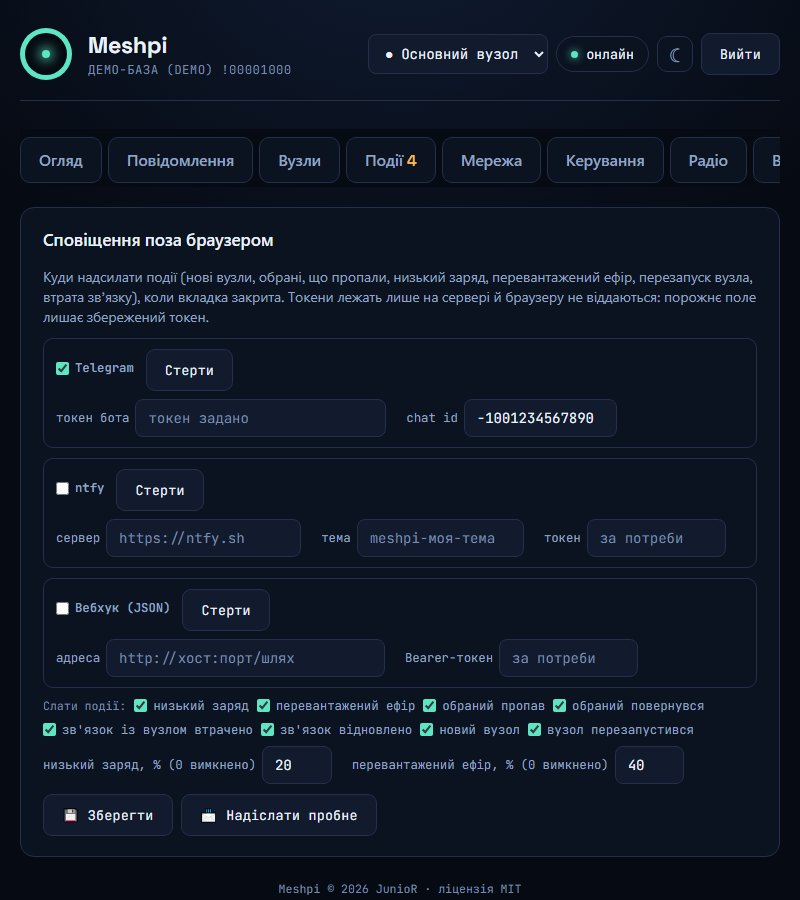

Куди надсилати події, коли вкладка закрита: **Telegram** (токен бота від @BotFather й chat id), **ntfy** (сервер, тема, за
потреби токен) і **вебхук** (JSON `{source, title, text, level, t}`, за потреби Bearer-токен). Для кожного виду події
можна ввімкнути чи вимкнути надсилання; пороги заряду й зайнятості ефіру там само. Токени зберігаються лише на сервері
(`data/notify.json`, права 600) і браузеру не віддаються: порожнє поле лишає збережений токен, «Стерти» видаляє канал.
Запити йдуть без редиректів і з таймаутом 8 с; кнопка «Надіслати пробне» показує результат по кожному каналу.

### Доступ «лише перегляд» і журнал дій

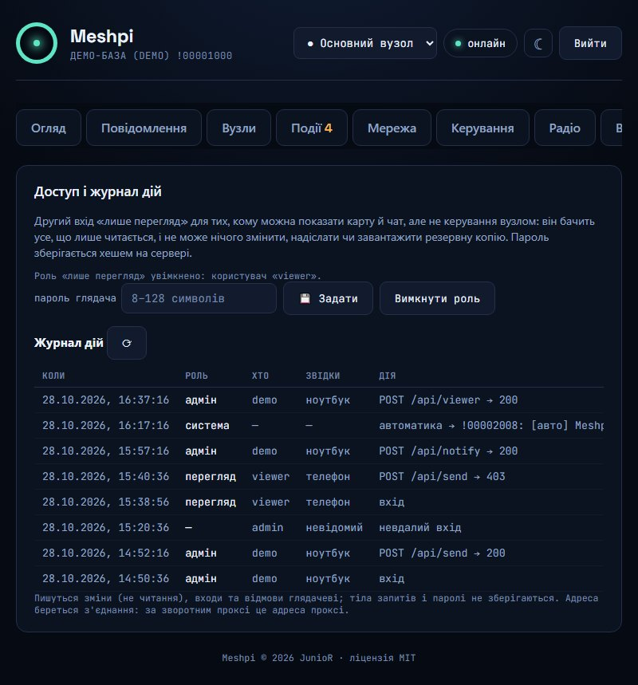

Адміністратор у «Системі» задає пароль для другого входу (ім'я `viewer`, змінюється `MESHPI_VIEWER_USER`; пароль можна
задати й змінною `MESHPI_VIEWER_PASSWORD`). Глядач бачить карту, чат, події, графіки, вимір дальності, журнал пакетів, але
не може нічого змінювати чи надсилати, не бачить налаштувань, адрес вузлів, ключів, резервних копій і системних сторінок:
сервер пропускає лише перелік дозволеного (GET-маршрути з переліку й вибір вузла), новий маршрут за замовчуванням закритий.
Зміна пароля глядача розлогінює його, вимкнення ролі теж. Журнал дій (2000 останніх рядків) пише входи, невдалі входи, кожну
зміну (не читання) з роллю, іменем, адресою й результатом, а також відмови глядачеві; адмін-завдання пишуться лише для змін (з розділом і вузлом, без значень), читання налаштувань не пишеться; **тіла запитів і паролі не пишуться**.
Адреса береться з'єднання: за зворотним проксі це адреса проксі.

### Автоматика: відповіді й оголошення

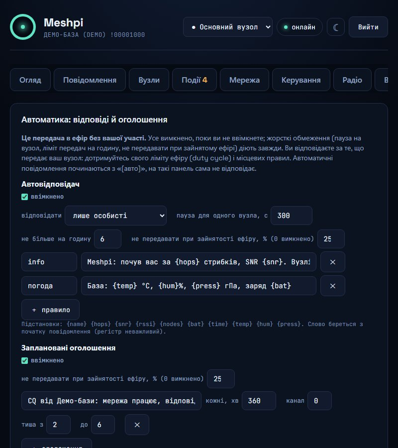

**Це передача в ефір без вашої участі, тому все вимкнено за замовчуванням.** Автовідповідач відповідає на слово-тригер на початку
повідомлення (до 10 правил, до 120 байт відповіді, підстановки `{name} {hops} {snr} {rssi} {nodes} {bat} {time} {temp} {hum} {press}`;
температура, вологість і тиск беруться з датчиків вашого вузла). Заплановані оголошення: до 5, не частіше за раз на 60 хв, з «тихими
годинами». Жорсткі обмеження діють завжди: пауза на вузол (від 60 с), не більше 1–30 передач на годину на все разом, не передавати,
коли зайнятість каналу вище порога (типово 25 %), не відповідати на давнє (понад 2 хв), на MQTT, на себе, на вузли цієї ж панелі й
на власні відповіді (усі автоматичні повідомлення починаються з «[авто]»). Особисте повідомлення отримує особисту відповідь. Кожну
передачу записано в журнал дій із роллю «система». Коли ввімкнено просту автовідповідь PONG (розділ «Автовідповідь» у вкладці «Вузол»), правило «ping» не
спрацьовує вдруге. Дотримуйтесь свого ліміту ефіру (duty cycle) і місцевих правил: відповідальність за передачу на вас.

### Перевірка безпеки

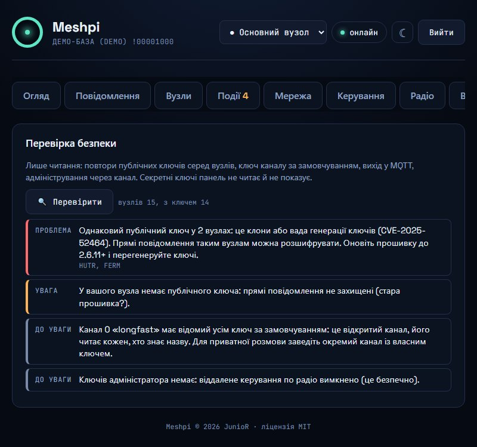

Лише читання: повтори публічних ключів серед вузлів (клони чи вада генерації ключів, CVE-2025-52464, виправлена в прошивці 2.6.11),
явно слабкі ключі, відсутність ключа у вашого вузла, канали без шифрування чи з відомим ключем за замовчуванням, вихід каналу в
MQTT, застаріле адміністрування через канал без ключів адміністратора. Секретні ключі панель не читає й не показує. Відкритий
канал із ключем за замовчуванням (LongFast) це звичайна справа, тому для нього лише примітка.

## Порівняння із застосунком Meshtastic для Android

Що з функцій застосунку вже є в панелі, а чого ще немає (✅ є · ◐ частково · ➖ немає):

| Можливість застосунку | Панель |
|---|---|
| Канали й приватні повідомлення, відповіді, реакції-емодзі | ✅ |
| Статус доставки (галочки) для приватних повідомлень | ✅ |
| Швидкі (готові) повідомлення | ✅ (читання/запис на вузлі, кнопки в чаті) |
| Сповіщення про нові повідомлення | ✅ (звук і сповіщення браузера, поки вкладка відкрита) |
| Список вузлів, пошук, фільтри, обрані/ігноровані/заглушені | ✅ (записується в список вузлів на вузлі) |
| Дані вузла, маршрут (traceroute), сигнал, показники пристрою | ✅ |
| Запит позиції, надсилання своєї позиції | ✅ |
| Карта вузлів | ◐ (OpenStreetMap, без шарів; плюс окрема «Мережа» з маршрутами й архівом, якої немає в застосунку) |
| Усі розділи налаштувань пристрою й модулів | ✅ (свій і віддалений вузол) |
| Керування віддаленими вузлами (Remote Administration) | ✅ (PKC-адмін по радіо) |
| Канали: редагування, QR-код/посилання, імпорт за посиланням | ✅ |
| Назва вузла, фіксована позиція, перезавантаження, вимкнення, скидання, очищення списку вузлів | ✅ |
| Журнал пакетів (debug) | ✅ |
| Кілька вузлів і перемикання між ними | ✅ |
| Довкілля, графіки каналу | ✅ |
| Точки на карті (waypoints): отримати, створити, змінити, видалити, заблокувати | ✅ |
| Історія позицій і треки вузлів на карті | ➖ |
| Графіки телеметрії окремого вузла (батарея, напруга, канал, довкілля, INA) | ✅ |
| Експорт/імпорт налаштувань вузла файлом | ◐ (резервна копія: канали, назва й історія; усіх розділів конфігурації ще немає) |
| Оновлення прошивки, підключення по Bluetooth/USB, сканування QR камерою | ➖ (поза можливостями веб-панелі: вона працює з TCP API вузла) |

---

## Налаштування середовища

| Змінна | Типово | Призначення |
|---|---|---|
| `MESH_HOST`, `MESH_PORT` | з `docker-compose.yml` | адреса першого вузла (`4403`); він стає підключенням «main», далі вузли ведуться в `nodes.json` |
| `MESHPI_USER`, `MESHPI_PASSWORD` | з `.env` | вхід у панель |
| `MESHPI_NODES_FILE` | `data/nodes.json` | список підключених вузлів (його веде сама панель) |
| `MESHPI_ENV_HOPS` | `3` | не далі скількох стрибків усереднювати довкілля |
| `MESHPI_TRACE_HOPS` | `5` | не далі скількох стрибків питати авто-маршрути |
| `MESHPI_TRACE_EVERY` | `10800` | період кола авто-маршрутів, с |
| `MESHPI_DB` | `/data/messages.db` | база (історія, графіки, довкілля, зв'язки) |
| `MESHPI_FAV_OFFLINE` | `1800` | скільки секунд не чути обраного, щоб вважати його «пропалим» |
| `MESHPI_VIEWER_USER`, `MESHPI_VIEWER_PASSWORD` | `viewer`, порожньо | ім'я й (за бажання) пароль входу «лише перегляд» |
| `MESHPI_TILE_URL`, `MESHPI_TILE_ATTR`, `MESHPI_TILE_ZOOM` | OpenStreetMap, `© OpenStreetMap`, `19` | власний сервер плиток карти для роботи без інтернету |
| `MESHPI_PKT_LOG` | `1000` | скільки пакетів тримати в журналі пакетів на підключення |
| `MESHPI_NO_EXTERNAL` | порожньо | `1` вимикає запити до open-meteo.com і forecast.solar |
| `MESHPI_NOTIFY_FILE`, `MESHPI_AUTO_FILE`, `MESHPI_SOLAR_FILE`, `MESHPI_NETVIEW_FILE` | `data/notify.json`, `auto.json`, `solar.json`, `netview.json` | налаштування сповіщень (з токенами), автоматики, сонячного вузла, погляду карти |

Дані панелі лежать у `data/` (поза git): `messages.db`, `password`, `viewerpw`, `secret.key`, `location.json`, `notify.json`
(токени), `auto.json`, `auto_state.json`, `solar.json`; прапорець вимкнених авто-маршрутів `notrace` теж там. Нічна копія
(`backup.sh`) бере й `notify.json` та `viewerpw`: бережіть каталог копій, як пароль.

## Як зняти скриншоти

Скриншоти в `docs/img/` зроблено на демо-сервері, він не підключається до радіо й не містить справжніх даних:

```bash
python tools/docs_demo.py webui 8099           # відкрийте http://127.0.0.1:8099
python tools/docs_demo.py webui 8099 --login   # те саме з паролем demo / demo (сторінка входу)
```

Потрібні `flask`, `waitress`, `meshtastic` (див. `webui/requirements.txt`).

Знімки окремих розділів 800×… знято headless Chrome: демо-сервер за параметром `?shot=<id секції>` залишає на сторінці лише цю секцію
вкладки (`&click=<id кнопок>` натискає їх, `&set=<id:значення>` заповнює поля), а PNG обрізається за вмістом:

```bash
chrome --headless=new --hide-scrollbars --window-size=800,900 --virtual-time-budget=20000 --run-all-compositor-stages-before-draw \
       --screenshot=out.png 'http://127.0.0.1:8099/?shot=healthbox#mesh'
```

Демо наповнює нові розділи вигаданими даними (LocalStats, Range Test, журнал дій, прогноз і рельєф підроблено локально,
в інтернет демо не ходить).